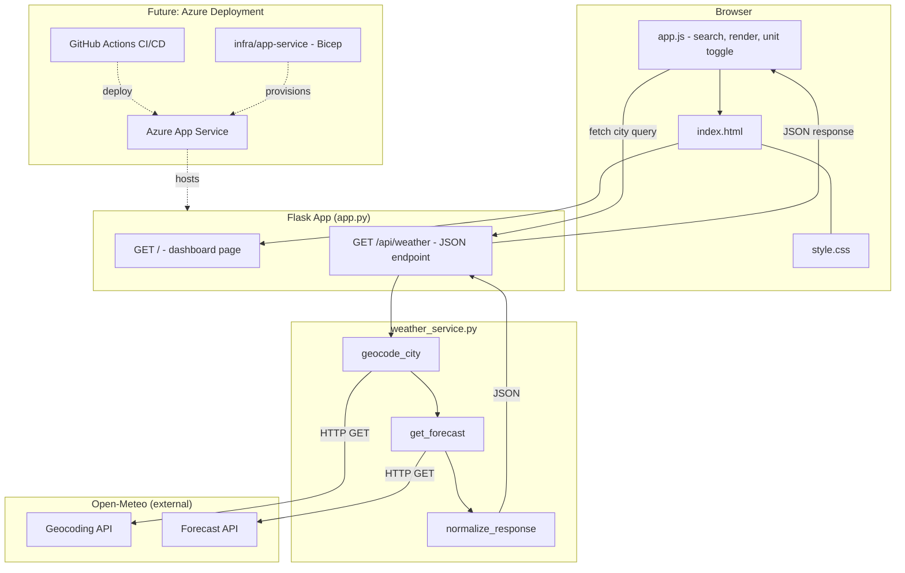
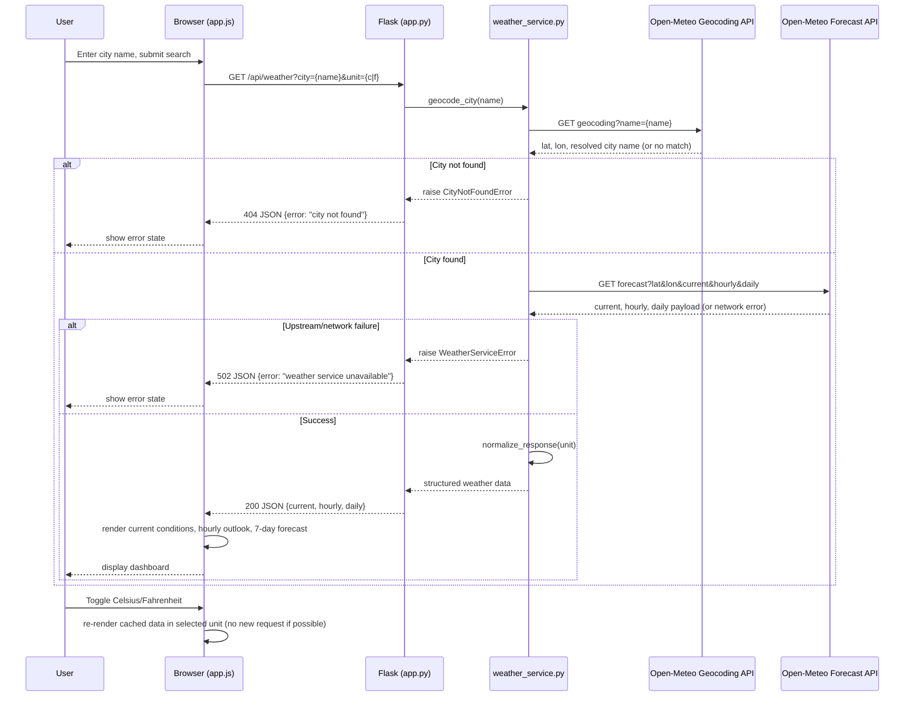

## Plan: Weather Dashboard

Build a responsive Flask weather dashboard in the existing Python workspace. Use Open-Meteo's public geocoding and forecast endpoints, so city search and live weather work without an API key.

**Steps**
1. Add minimal dependencies. Keep `app.py` focused on Flask routes and move Open-Meteo requests, validation, and response normalization into `weather_service.py`; use timeouts and return clear errors for unknown cities, network/API failures, or incomplete data.
2. Add the dashboard page template and client-side behavior: city search, current conditions, hourly outlook, 7-day forecast, and Celsius/Fahrenheit switching. Keep API responses structured and avoid embedding credentials or hardcoding weather values.
3. Add focused styling for a legible, responsive weather dashboard, including loading, empty, and error states; ensure desktop and mobile layouts remain usable.
4. Add focused checks for the Flask route and the geocoding/forecast response handling, using mocked HTTP responses so tests do not require external network access.
5. Future deployment phase, after the app works locally: add GitHub Actions CI/deployment workflow(s) under `.github/workflows/` and App Service infrastructure under `infra/app-service/` using Bicep. Keep the app deployable as a standard Python web app. Add an `infra/aks/` target only when AKS deployment is actually scheduled.

**Project structure**

- `app.py` — Flask setup, dashboard route, and JSON endpoint for browser requests.
- `weather_service.py` — city geocoding and forecast calls, validation, and response normalization.
- `requirements.txt` — Flask, requests, and pytest.
- `templates/index.html` — dashboard markup.
- `static/css/style.css` — responsive styling and loading/error states.
- `static/js/app.js` — search, rendering, and unit switching.
- `tests/test_app.py` — route and weather-service tests with mocked HTTP responses.

Keep application code at the workspace root. When deployment work begins, add `.github/workflows/ci.yml` for tests and `.github/workflows/deploy-app-service.yml` for deployment, plus `infra/app-service/main.bicep` and environment parameter files under `infra/app-service/`. Add `infra/aks/` only when AKS is scheduled; do not create empty folders now. Add a README or app package structure only if setup instructions or growth make them useful.

**Verification**
1. Install dependencies and run the focused test suite with HTTP calls mocked.
2. Start the Flask app and search for a known city; confirm current conditions, hourly data, and 7-day data render.
3. Exercise invalid-city and network-failure states, and switch units; confirm values and labels update consistently.
4. Check the page at narrow mobile and desktop widths for readable, non-overlapping controls and forecast data.
5. In the future deployment phase, validate the Bicep templates and CI workflow, then verify an App Service deployment in a non-production environment.

**Decisions**
- Framework: Flask with plain HTML/CSS/JavaScript, matching the user's selection.
- Weather provider: Open-Meteo geocoding and forecast APIs; no key required.
- Location workflow: user searches by city; no browser geolocation.
- Initial feature scope: current conditions, hourly outlook, 7-day forecast, and temperature-unit toggle. Exclude accounts, saved cities, maps, alerts, and deployment implementation in the initial dashboard phase.
- Future deployment target: Azure App Service first; AKS is a separate later target, not part of the first deployment implementation.
- `weather_service.py` owns all outbound HTTP calls and error normalization; `app.py` only translates service results/errors into HTTP responses.
- Unit toggle re-renders already-fetched data client-side where possible; only issues a new `/api/weather` request if no cached payload exists.

**Architecture Diagram**

**Data Flow Diagram**

